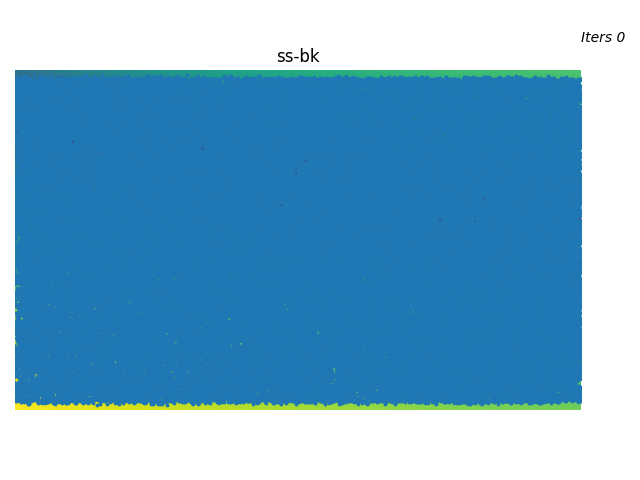
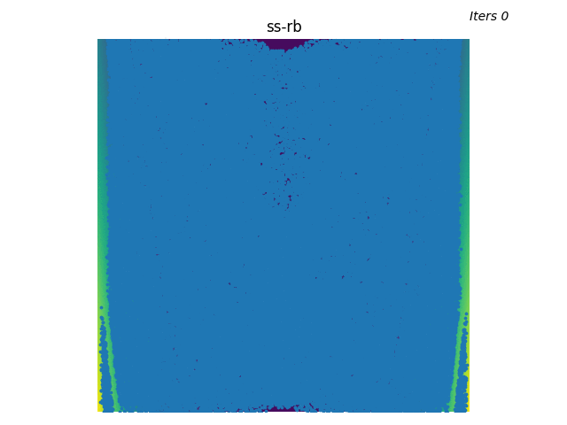
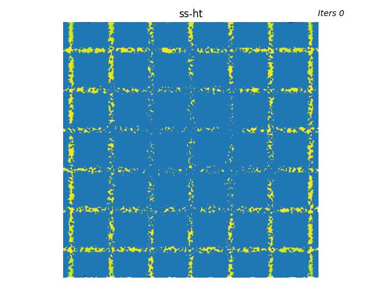
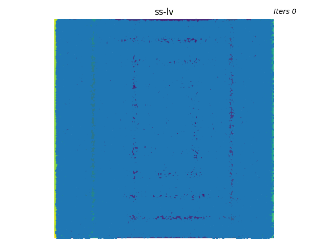

# Sinkhorn Step in JAX (`ssax`)

[](https://opensource.org/licenses/MIT)
[](https://www.python.org/downloads/)
[](https://github.com/google/jax)
[](https://proceedings.neurips.cc/paper_files/paper/2023/file/f7a94134f1c726796c6f81fb946e489d-Paper-Conference.pdf)

**`ssax`** is a high-performance JAX implementation of the **Sinkhorn Step**—a batch gradient-free optimizer for highly non-convex objectives.

It leverages the power of [OTT-JAX](https://github.com/ott-jax/ott) for robust and differentiable optimal transport solvers, enabling efficient exploration of complex landscapes.

<p align="center">
  
   
  
</p>
<p align="center">
  
   
  
</p>

> **Note:** This repository provides the **JAX** implementation of the Sinkhorn Step as a standalone optimizer. For the MPOT trajectory optimizer (PyTorch version), please visit [mpot](https://github.com/anindex/mpot).

## Paper

This work was accepted to **NeurIPS 2023**.
[**Accelerating Motion Planning via Optimal Transport**](https://proceedings.neurips.cc/paper_files/paper/2023/file/f7a94134f1c726796c6f81fb946e489d-Paper-Conference.pdf)

## Installation

1. **Clone the repository:**
  ```bash
   git clone [https://github.com/anindex/ssax.git](https://github.com/anindex/ssax.git)
   cd ssax
  ```

2.  **Install dependencies:**
    It is recommended to use a fresh conda environment.

    ```bash
    pip install -e .
    ```

    **GPU Support:** To run on GPU, you must install the CUDA-enabled version of JAX manually:

    ```bash
    pip install -U "jax[cuda13]"
    ```

    (Check the [JAX Installation Guide](https://github.com/google/jax#installation) for your specific CUDA version)

## Usage

### 1\. Quick Example

Run a simple optimization on the Ackley function:

```bash
# Run with default settings (Ackley 2D)
python scripts/example.py --objective Ackley --num_points 1000

# Try a different function
python scripts/example.py --objective Rosenbrock --num_points 5000 --max_iters 50
```

### 2\. Visualize Objective Functions

Explore the landscape of the available synthetic test functions:

```bash
# View a gallery of all functions
python scripts/visualize_objectives.py

# Inspect a specific function in 3D
python scripts/visualize_objectives.py --name Rastrigin
```

### 3\. Run Experiments (Hydra)

Use `hydra` to run configured experiments. Results (plots/animations) are saved in the `logs/` directory.

```bash
python scripts/run.py experiment=ss-al
```

**Available Experiments:**
| Config Name | Function | Dim |
|:---|:---|:---:|
| `ss-al` | Ackley | 2D |
| `ss-al-10d` | Ackley | 10D |
| `ss-bk` | Bukin | 2D |
| `ss-eh` | EggHolder | 2D |
| `ss-rb` | Rosenbrock | 2D |
| `ss-st` | Styblinski-Tang | 2D |

> **Hyperparameter Tuning:** The critical parameters are `step_radius`, `probe_radius`, and `ent_epsilon`. You can override them from the command line:
>
> ```bash
> python scripts/run.py experiment=ss-al optimizer.kwargs.step_radius=0.2
> ```

## Benchmarking

We evaluate the quality of the Sinkhorn Step direction compared to the true gradient (cosine similarity).

**Run single-seed analysis (Violin/Box plots):**

```bash
python scripts/benchmark_cosin_similarity_single.py experiment=ss-st-cosin-sim num_seeds=20
```

**Run multi-epsilon sweep (Line plots):**

```bash
python scripts/benchmark_cosin_similarity.py experiment=ss-st-cosin-sim num_seeds=5
```

## Citation

If you found this work useful, please consider citing this reference:

```bibtex
@article{le2023accelerating,
  title={Accelerating motion planning via optimal transport},
  author={Le, An T and Chalvatzaki, Georgia and Biess, Armin and Peters, Jan R},
  journal={Advances in Neural Information Processing Systems},
  volume={36},
  pages={78453--78482},
  year={2023}
}
```

## Acknowledgments

  - [OTT-JAX](https://github.com/ott-jax/ott): The backbone for our differentiable linear solvers.
  - [SFU Optimization Library](http://www.sfu.ca/~ssurjano/optimization.html): Source for synthetic test function definitions.
